  <picture>
    <source media="(prefers-color-scheme: dark)" srcset="./assets/hero-dark.svg" />
    <source media="(prefers-color-scheme: light)" srcset="./assets/hero-light.svg" />
    
  </picture>

   

  

    
    
    <!-- Uncomment & update URLs below when ready:
    
    -->
  

---

### About Me

<table width="100%">
  <tr>
    <td width="54%" valign="top">
      

        I'm <strong>Huynh Minh Tam</strong>, a <strong>Full-Stack Developer</strong> based in Ho Chi Minh City, Vietnam, pursuing Information Technology at <strong>PTIT HCMC</strong>.
      

      

        I focus on building reliable, maintainable web applications end-to-end — pairing clean, modular backend APIs (<strong>NestJS, Express, Prisma, PostgreSQL</strong>) with responsive, type-safe interfaces (<strong>React, Next.js, TypeScript, Tailwind CSS</strong>). Alongside full-stack web engineering, I enjoy working on distributed database systems and query optimization with <strong>Python</strong>.
      

    </td>
    <td width="46%" valign="top">
      <strong>Engineering Focus</strong>
      <ul>
        <li><strong>Backend Architecture:</strong> Modular REST APIs, JWT &amp; RBAC authorization, strict DTO validation, and audit logging.</li>
        <li><strong>Modern Frontend:</strong> Type-safe React &amp; Next.js applications, Tailwind CSS design systems, and interactive dashboards.</li>
        <li><strong>Data &amp; Systems:</strong> Relational schema design, ORM lifecycle management, and distributed query cost optimization.</li>
      </ul>
    </td>
  </tr>
</table>

---

### Tech Stack & Tooling

<table width="100%">
  <tr>
    <td width="22%"><strong>Languages</strong></td>
    <td width="78%">
      
      
      
      
      
      
    </td>
  </tr>
  <tr>
    <td><strong>Frontend</strong></td>
    <td>
      
      
      
      
      
      
    </td>
  </tr>
  <tr>
    <td><strong>Backend &amp; API</strong></td>
    <td>
      
      
      
      
      
      
    </td>
  </tr>
  <tr>
    <td><strong>Data &amp; DevTools</strong></td>
    <td>
      
      
      
      
      
      
      
    </td>
  </tr>
</table>

---

### Featured Projects

<table width="100%">
  <tr>
    <td width="50%" valign="top">
      <h4>
        <a href="https://github.com/iammintam5/dormitory-facility-management">Dormitory Facility Management System</a>
      </h4>
      

        End-to-end web platform managing dormitory buildings, room allocation, asset lifecycles, damage reporting, maintenance scheduling, and liquidation workflows. Engineered with 3-tier Role-Based Access Control (Admin, Manager, Student), analytics charts, QR support, and system-wide audit logs.
      

      

        <code>NestJS</code>
        <code>PostgreSQL</code>
        <code>Prisma</code>
        <code>JWT</code>
        <code>React 18</code>
        <code>TypeScript</code>
        <code>Tailwind CSS</code>
        <code>Recharts</code>
      

    </td>
    <td width="50%" valign="top">
      <h4>
        <a href="https://github.com/iammintam5/cbo_social_media">Distributed DB Cost-Based Optimizer</a>
      </h4>
      

        Interactive simulation prototype modeling query execution plans across a distributed social media database. Benchmarks fragment localization, pruning, and semi-join optimization strategies to evaluate and minimize cross-node communication costs.
      

      

        <code>Python</code>
        <code>Distributed DB</code>
        <code>Query Optimization</code>
        <code>Streamlit</code>
        <code>Pandas</code>
        <code>Plotly</code>
      

    </td>
  </tr>
  <tr>
    <td width="50%" valign="top">
      <h4>
        <a href="https://github.com/iammintam5/N23DCCN052_HuynhMinhTam_Lab3_Fullstack-shop">Full-Stack E-Commerce Platform</a>
      </h4>
      

        Decoupled client-server storefront architecture combining a modern Next.js &amp; React 19 user interface with a lightweight Express REST API backend, responsive product browsing, and clean state interactions.
      

      

        <code>Next.js</code>
        <code>React 19</code>
        <code>TypeScript</code>
        <code>Tailwind CSS</code>
        <code>Express.js</code>
      

    </td>
    <td width="50%" valign="top">
      <h4>
        <a href="https://github.com/iammintam5?tab=repositories">More Projects &amp; Coursework</a>
      </h4>
      

        Explore additional repositories covering full-stack web engineering labs, distributed query simulation engines (<code>cbo_project</code>), RESTful service design, and modern frontend development practices.
      

      

        <a href="https://github.com/iammintam5?tab=repositories"><strong>Explore all repositories &rarr;</strong></a>
      

    </td>
  </tr>
</table>

 

  <picture>
    <source media="(prefers-color-scheme: dark)" srcset="./assets/footer-dark.svg" />
    <source media="(prefers-color-scheme: light)" srcset="./assets/footer-light.svg" />
    
  </picture>

