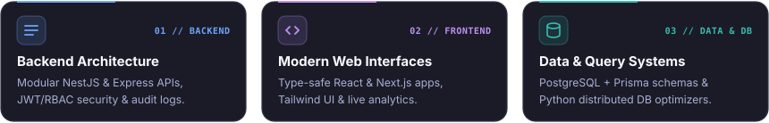
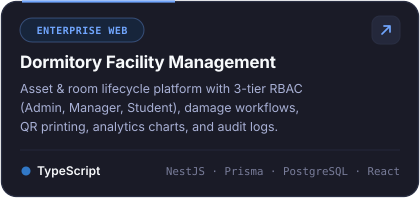
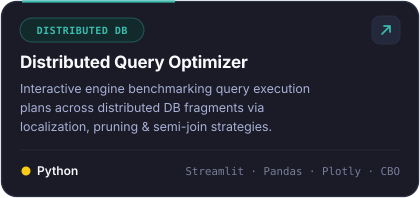
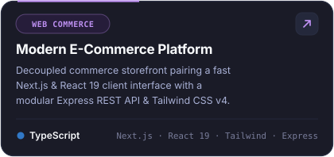
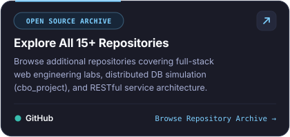

  <!-- Animated Aurora Hero Banner -->
  <picture>
    <source media="(prefers-color-scheme: dark)" srcset="./assets/hero-dark.svg" />
    <source media="(prefers-color-scheme: light)" srcset="./assets/hero-light.svg" />
    
  </picture>

  <!-- Live Typing Effect -->
  

    <picture>
      <source media="(prefers-color-scheme: dark)" srcset="https://readme-typing-svg.demolab.com?font=JetBrains+Mono&weight=600&size=17&duration=3200&pause=1100&color=70A5FD&center=true&vCenter=true&width=760&height=38&lines=Architecting+Modular+Backend+APIs+with+NestJS+%26+Node.js;Building+Fast,+Type-Safe+Web+UIs+with+React+%26+Next.js;Designing+Relational+Schemas+%26+Distributed+Query+Engines;Turning+Complex+Problems+into+Clean,+Scalable+Software" />
      <source media="(prefers-color-scheme: light)" srcset="https://readme-typing-svg.demolab.com?font=JetBrains+Mono&weight=600&size=17&duration=3200&pause=1100&color=0284C7&center=true&vCenter=true&width=760&height=38&lines=Architecting+Modular+Backend+APIs+with+NestJS+%26+Node.js;Building+Fast,+Type-Safe+Web+UIs+with+React+%26+Next.js;Designing+Relational+Schemas+%26+Distributed+Query+Engines;Turning+Complex+Problems+into+Clean,+Scalable+Software" />
      
    </picture>
  

  <!-- Quick Connect Buttons -->
  

    &nbsp;&nbsp;&nbsp;&nbsp;
    <!-- Uncomment to add LinkedIn or Portfolio:
    &nbsp;&nbsp;
    -->
  

   

  <!-- 3-Pillar Engineering Capabilities -->
  <picture>
    <source media="(prefers-color-scheme: dark)" srcset="./assets/highlights-dark.svg" />
    <source media="(prefers-color-scheme: light)" srcset="./assets/highlights-light.svg" />
    
  </picture>

 

### 🛠️ Tech Ecosystem & Tooling

  
<strong>LANGUAGES &amp; MODERN FRONTEND</strong>

  

    <picture>
      <source media="(prefers-color-scheme: dark)" srcset="https://skillicons.dev/icons?i=ts,js,py,react,nextjs,tailwind,vite,html,css&theme=dark" />
      <source media="(prefers-color-scheme: light)" srcset="https://skillicons.dev/icons?i=ts,js,py,react,nextjs,tailwind,vite,html,css&theme=light" />
      
    </picture>
  

  
<strong>BACKEND, DATABASE &amp; DEVTOOLS</strong>

  

    <picture>
      <source media="(prefers-color-scheme: dark)" srcset="https://skillicons.dev/icons?i=nodejs,nestjs,express,prisma,postgres,jest,git,github,postman,vscode&theme=dark" />
      <source media="(prefers-color-scheme: light)" srcset="https://skillicons.dev/icons?i=nodejs,nestjs,express,prisma,postgres,jest,git,github,postman,vscode&theme=light" />
      
    </picture>
  

 

### 🚀 Featured Engineering Projects

  <a href="https://github.com/iammintam5/dormitory-facility-management"><picture><source media="(prefers-color-scheme: dark)" srcset="./assets/project-dormitory-dark.svg" /><source media="(prefers-color-scheme: light)" srcset="./assets/project-dormitory-light.svg" /></picture></a>
  <a href="https://github.com/iammintam5/cbo_social_media"><picture><source media="(prefers-color-scheme: dark)" srcset="./assets/project-cbo-dark.svg" /><source media="(prefers-color-scheme: light)" srcset="./assets/project-cbo-light.svg" /></picture></a>

  <a href="https://github.com/iammintam5/N23DCCN052_HuynhMinhTam_Lab3_Fullstack-shop"><picture><source media="(prefers-color-scheme: dark)" srcset="./assets/project-shop-dark.svg" /><source media="(prefers-color-scheme: light)" srcset="./assets/project-shop-light.svg" /></picture></a>
  <a href="https://github.com/iammintam5?tab=repositories"><picture><source media="(prefers-color-scheme: dark)" srcset="./assets/project-more-dark.svg" /><source media="(prefers-color-scheme: light)" srcset="./assets/project-more-light.svg" /></picture></a>

 

### 📊 GitHub Analytics & Activity

  <picture>
    <source media="(prefers-color-scheme: dark)" srcset="https://github-profile-summary-cards.vercel.app/api/cards/profile-details?username=iammintam5&theme=tokyonight" />
    <source media="(prefers-color-scheme: light)" srcset="https://github-profile-summary-cards.vercel.app/api/cards/profile-details?username=iammintam5&theme=github" />
    
  </picture>

  <picture>
    <source media="(prefers-color-scheme: dark)" srcset="https://github-profile-summary-cards.vercel.app/api/cards/stats?username=iammintam5&theme=tokyonight" />
    <source media="(prefers-color-scheme: light)" srcset="https://github-profile-summary-cards.vercel.app/api/cards/stats?username=iammintam5&theme=github" />
    
  </picture>
  <picture>
    <source media="(prefers-color-scheme: dark)" srcset="https://github-profile-summary-cards.vercel.app/api/cards/repos-per-language?username=iammintam5&theme=tokyonight" />
    <source media="(prefers-color-scheme: light)" srcset="https://github-profile-summary-cards.vercel.app/api/cards/repos-per-language?username=iammintam5&theme=github" />
    
  </picture>

  <picture>
    <source media="(prefers-color-scheme: dark)" srcset="https://raw.githubusercontent.com/iammintam5/iammintam5/output/github-snake-dark.svg" />
    <source media="(prefers-color-scheme: light)" srcset="https://raw.githubusercontent.com/iammintam5/iammintam5/output/github-snake.svg" />
    
  </picture>

 

  <picture>
    <source media="(prefers-color-scheme: dark)" srcset="./assets/footer-dark.svg" />
    <source media="(prefers-color-scheme: light)" srcset="./assets/footer-light.svg" />
    
  </picture>

