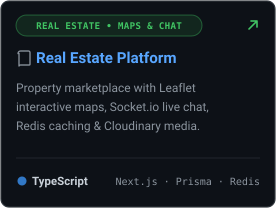
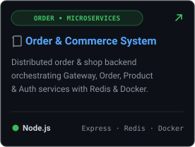

<h2 align="center"> Hey Everyone, I'm Huynh Minh Tam</h2>

  <picture>
    <source media="(prefers-color-scheme: dark)" srcset="https://readme-typing-svg.demolab.com?font=Fira+Code&weight=600&size=27&pause=1000&color=40c463&center=true&vCenter=true&width=820&height=52&lines=%F0%9F%92%BB+Welcome+to+My+GitHub+Universe!;%F0%9F%9A%80+Crafting+Code%2C+Building+Scalable+Systems;%E2%9A%A1+Full-Stack+Developer+%7C+TypeScript+%26+Node.js" />
    <source media="(prefers-color-scheme: light)" srcset="https://readme-typing-svg.demolab.com?font=Fira+Code&weight=600&size=27&pause=1000&color=1a7f37&center=true&vCenter=true&width=820&height=52&lines=%F0%9F%92%BB+Welcome+to+My+GitHub+Universe!;%F0%9F%9A%80+Crafting+Code%2C+Building+Scalable+Systems;%E2%9A%A1+Full-Stack+Developer+%7C+TypeScript+%26+Node.js" />
    
  </picture>

- 👨‍💻 Building practical, scalable **Full-Stack Web Applications**, **Microservices** & **RESTful APIs**
- 📖 Focused on clean architecture, continuous learning, and code quality
- 🛠️ Working across **TypeScript, Python, Next.js, React, NestJS, Express, PostgreSQL, Redis & Docker**
- 👥 Open to collaboration & **Full-Stack / Backend Developer** opportunities
- 📍 Based in **Ho Chi Minh City, Vietnam**

  

  
  
  <!-- Uncomment & add your social links anytime:
  
  
  -->

 

  

    <picture>
      <source media="(prefers-color-scheme: dark)" srcset="https://github-profile-summary-cards.vercel.app/api/cards/profile-details?username=iammintam5&theme=github_dark" />
      <source media="(prefers-color-scheme: light)" srcset="https://github-profile-summary-cards.vercel.app/api/cards/profile-details?username=iammintam5&theme=github" />
      
    </picture>
  

  

    <picture>
      <source media="(prefers-color-scheme: dark)" srcset="https://github-profile-summary-cards.vercel.app/api/cards/stats?username=iammintam5&theme=github_dark" />
      <source media="(prefers-color-scheme: light)" srcset="https://github-profile-summary-cards.vercel.app/api/cards/stats?username=iammintam5&theme=github" />
      
    </picture>
    <picture>
      <source media="(prefers-color-scheme: dark)" srcset="https://github-profile-summary-cards.vercel.app/api/cards/productive-time?username=iammintam5&theme=github_dark&utcOffset=7" />
      <source media="(prefers-color-scheme: light)" srcset="https://github-profile-summary-cards.vercel.app/api/cards/productive-time?username=iammintam5&theme=github&utcOffset=7" />
      
    </picture>
  

  

    <picture>
      <source media="(prefers-color-scheme: dark)" srcset="https://github-profile-summary-cards.vercel.app/api/cards/repos-per-language?username=iammintam5&theme=github_dark" />
      <source media="(prefers-color-scheme: light)" srcset="https://github-profile-summary-cards.vercel.app/api/cards/repos-per-language?username=iammintam5&theme=github" />
      
    </picture>
    <picture>
      <source media="(prefers-color-scheme: dark)" srcset="https://github-profile-summary-cards.vercel.app/api/cards/most-commit-language?username=iammintam5&theme=github_dark" />
      <source media="(prefers-color-scheme: light)" srcset="https://github-profile-summary-cards.vercel.app/api/cards/most-commit-language?username=iammintam5&theme=github" />
      
    </picture>
  

  

    <picture>
      <source media="(prefers-color-scheme: dark)" srcset="https://raw.githubusercontent.com/iammintam5/iammintam5/output/github-snake-dark.svg" />
      <source media="(prefers-color-scheme: light)" srcset="https://raw.githubusercontent.com/iammintam5/iammintam5/output/github-snake.svg" />
      
    </picture>
  

---

### Tech Stack & Tools

**Languages**

  
  
  
  
  
  
  
  

**Frontend & UI Ecosystem**

  
  
  
  
  
  
  
  
  

**Backend, APIs & Real-Time**

  
  
  
  
  
  
  
  
  

**Databases, ORM & Cloud Storage**

  
  
  
  
  
  
  

**DevOps, Data & Developer Tools**

  
  
  
  
  
  
  
  
  
  

### Featured Projects

  <a href="https://github.com/Longdev1701/Real_Estate_Transaction_Platform"><picture><source media="(prefers-color-scheme: dark)" srcset="./assets/project-realestate-dark.svg" /><source media="(prefers-color-scheme: light)" srcset="./assets/project-realestate-light.svg" /></picture></a>
  <a href="https://github.com/Longdev1701/villa_booking-website"><picture><source media="(prefers-color-scheme: dark)" srcset="./assets/project-villa-dark.svg" /><source media="(prefers-color-scheme: light)" srcset="./assets/project-villa-light.svg" /></picture></a>
  <a href="https://github.com/iammintam5/N23DCCN052_HuynhMinhTam_Lab2"><picture><source media="(prefers-color-scheme: dark)" srcset="./assets/project-order-dark.svg" /><source media="(prefers-color-scheme: light)" srcset="./assets/project-order-light.svg" /></picture></a>

  

  <b>Note:</b> Public repositories highlight selected coursework, architectures, and collaborative builds — additional real-world projects are maintained across team and private repositories.

