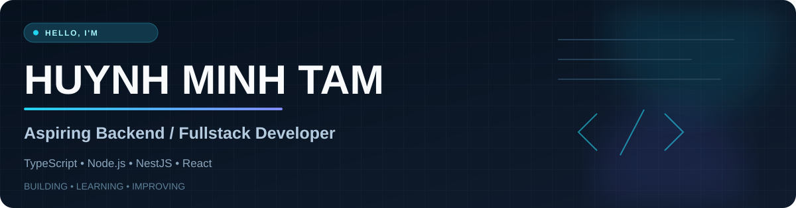

 

## 01 / About me

I'm **Huynh Minh Tam**, an Information Technology student with an interest in **backend engineering** and **fullstack web development**. I build practical applications while strengthening my programming fundamentals, database skills, and understanding of web architecture.

- 🎯 **Goal:** Fresher / Intern Backend or Fullstack Developer
- 🌱 **Currently learning:** JavaScript, TypeScript, Node.js, Express, and NestJS
- 🧩 **Interested in:** REST APIs, authentication, relational databases, and maintainable code
- 📍 **Based in:** Ho Chi Minh City, Vietnam

## 02 / Technologies I've worked with

**Languages & UI**

**Backend & Data**

**Workflow**

> I'm actively learning these technologies. The icons represent tools used or explored in my projects, not expert-level proficiency.

## 03 / Featured projects

<table>
<tr>
<td width="50%" valign="top">

### 🏢 [Dormitory Facility Management](https://github.com/iammintam5/dormitory-facility-management)

Fullstack dormitory management system for tracking rooms, assets, damage reports, and maintenance.

**Highlights**
- NestJS REST API and JWT authentication
- Admin, manager, and student roles
- React dashboard and PostgreSQL data storage

`NestJS` `React` `TypeScript` `Prisma` `PostgreSQL`

</td>
<td width="50%" valign="top">

### 📊 [Distributed Query Optimizer](https://github.com/iammintam5/cbo_social_media)

Interactive simulation exploring cost-based optimization strategies for distributed databases.

**Highlights**
- Query execution plan comparisons
- Localization and semi-join scenarios
- Streamlit interactive interface

`Python` `Streamlit` `Distributed DB`

</td>
</tr>
<tr>
<td colspan="2" valign="top">

### 🧠 [Cost-Based Optimizer](https://github.com/iammintam5/cbo_project)

Python simulation that models communication, CPU, and I/O costs to compare distributed query execution plans and select a lower-cost strategy.

`Python` `Query Optimization` `Database Systems`

</td>
</tr>
</table>

## 04 / GitHub activity

Activity cards depend on third-party services and may sometimes be unavailable. Language statistics reflect repository code, not skill level.

---

**Open to Fresher / Intern Backend & Fullstack opportunities**

<a href="mailto:huynhminhtam8842@gmail.com">Get in touch</a> · <a href="https://github.com/iammintam5">GitHub</a>

Keep building. Keep learning. Keep improving.

